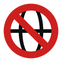
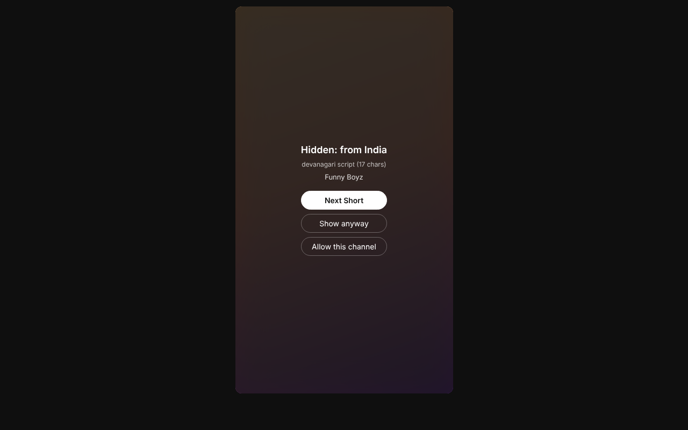
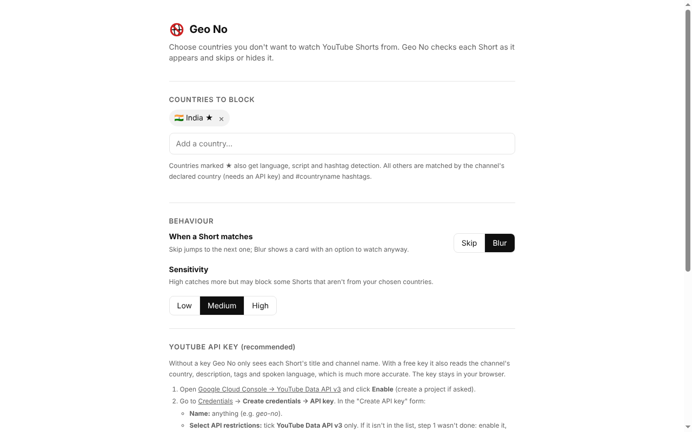

<p align="center"></p>

<h1 align="center">Geo No: Block YouTube Shorts by Country</h1>

<p align="center"><b>A free, open-source Chrome extension that hides or skips YouTube Shorts from countries you choose not to watch.</b><br>
Tired of your Shorts feed being full of content from one country? Pick the country and Geo No filters it out as you scroll.</p>

<p align="center">
  <a href="https://github.com/addester/geo-no/releases/latest"><b>⬇ Download</b></a> ·
  <a href="https://addester.github.io/geo-no/">Website</a> ·
  <a href="#install-2-minutes">Install guide</a> ·
  <a href="#how-it-decides-where-a-short-is-from">How it works</a> ·
  <a href="docs/privacy.html">Privacy</a>
</p>

<p align="center"></p>

---

## What it does

- **Block Shorts from any country.** For example, block Indian YouTube Shorts if you're in the US, or block content from any of 240+ countries and territories.
- **Skip or blur:** auto-skip to the next Short, or blur it with *Show anyway* and *Allow this channel* buttons.
- **Works as you scroll:** each Short is paused for a split second while Geo No checks it, so blocked content never plays.
- **Allow list:** mark a channel as fine and it's never blocked again.
- **Private:** no account, no tracking, no server. Everything stays in your browser.
- Works in **Chrome, Edge, Brave, Arc, Opera** and other Chromium browsers.

It works like a website blocker or "de-addiction" app, but for **where content comes from** instead of which site it's on.

## Install (2 minutes)

1. **Download** `geo-no-extension.zip` from the [latest release](https://github.com/addester/geo-no/releases/latest) and unzip it.
2. Open `chrome://extensions` (or `edge://extensions`, `brave://extensions`).
3. Turn on **Developer mode** (top-right toggle).
4. Click **Load unpacked** and select the unzipped `extension` folder.
5. The settings page opens. Choose the countries you want to block.
6. *(Recommended)* Add a free YouTube API key ([steps below](#get-a-free-youtube-api-key-recommended)).
7. Open YouTube Shorts and scroll.

> Chrome Web Store listing coming soon. It will make installing a one-click job.



## Get a free YouTube API key (recommended)

Without a key, Geo No only sees each Short's **title and channel name**. With a key it also reads the **channel's country, description, tags and spoken language**, which is far more accurate. The key is free and stays in your browser.

1. Open [Google Cloud Console → YouTube Data API v3](https://console.cloud.google.com/apis/library/youtube.googleapis.com) and click **Enable** (create a project first if asked).
2. Go to [Credentials](https://console.cloud.google.com/apis/credentials) → **Create credentials → API key**. In the *Create API key* form:
   - **Name:** anything, e.g. `geo-no`.
   - **Select API restrictions:** tick **YouTube Data API v3** only. *If it isn't listed, step 1 wasn't done: enable the API, then come back.*
   - **Application restrictions:** leave on **None**. ("Websites" blocks the extension's own requests. Restricting the key to the YouTube API is enough: a leaked key could only use up your free YouTube quota.)
   - Ignore the **"Service account required"** notice. It only applies to Gemini / Agent Platform.
   - Click **Create** and copy the key (starts with `AIza`).
3. In Geo No settings, paste the key and click **Save & test**. You should see **✓ Key works**.

The free quota (10,000 units/day) covers roughly 5,000 Shorts a day.

## How it decides where a Short is from

There's no "country" label on a video, and the network can't tell either: every Short comes from the same YouTube servers. So Geo No looks at each Short as it appears and weighs several clues:

| Signal | Example | Strength |
|---|---|---|
| Channel's declared country *(API key)* | `country: IN` | Decisive |
| Writing script | Devanagari, Telugu, Tamil, Gujarati, Bengali, Thai, Hangul… | Strong |
| Spoken / default language *(API key)* | `hi`, `ta`, `te`, `mr`, `ko`, `ja`… | Strong |
| Romanised Hindi ("Hinglish") | bhai, yaar, kya, nahi… | Medium |
| Hashtags and place names | `#mumbai #desi #bollywood #ipl` | Medium |

The clues are combined into a 0–1 score and compared with your **sensitivity** (Low 0.85 · Medium 0.70 · High 0.50). If a channel says it's based in another country, the content clues count for half.

Rich language profiles exist for 🇮🇳 India, 🇵🇰 Pakistan, 🇧🇩 Bangladesh, 🇳🇵 Nepal, 🇱🇰 Sri Lanka, 🇹🇭 Thailand, 🇰🇷 South Korea, 🇯🇵 Japan, 🇮🇱 Israel, 🇬🇪 Georgia, 🇦🇲 Armenia, 🇰🇭 Cambodia, 🇱🇦 Laos, 🇲🇲 Myanmar and 🇪🇹 Ethiopia. Every other country is matched by the channel's declared country and `#countryname` hashtags. **Adding a profile for your country is a great first contribution** (see `PROFILES` in [`extension/classifier.js`](extension/classifier.js)).

## Privacy

Geo No has no server and collects nothing. Settings, your API key and the channel cache live in your browser's extension storage. The only network requests go to Google's YouTube Data API (with your own key) and YouTube's public oEmbed endpoint, to read a Short's title and channel. Full policy: [docs/privacy.html](docs/privacy.html).

## Known limits

- **Browser only.** It works on youtube.com, not in the YouTube mobile app.
- YouTube changes its page layout often. If skipping stops working, please [open an issue](https://github.com/addester/geo-no/issues).
- Creators with English-only titles and no declared country can slip through without an API key.

## Roadmap

- [x] YouTube Shorts (Chrome / Edge / Brave)
- [ ] Chrome Web Store and Edge Add-ons listing
- [ ] Instagram Reels on the web
- [ ] Hide Shorts shelves on the YouTube home page and search results
- [ ] Android app (Instagram Reels and YouTube Shorts)
- [ ] Shared, opt-in channel→country database

## Contributing

Issues and pull requests are welcome. To work on it:

```bash
git clone https://github.com/addester/geo-no.git
cd geo-no
node tests/classifier.test.js   # detection tests, no dependencies
```

Load the `extension/` folder with **Load unpacked**, then click ↻ on the extension card after each change.

| File | What it does |
|---|---|
| `extension/content.js` | Watches the Shorts player, pauses while checking, skips or blurs |
| `extension/background.js` | Fetches metadata, caches channels, applies the allow list, counts stats |
| `extension/classifier.js` | Detection logic. Pure JS, testable in Node |
| `extension/options.*`, `popup.*` | Settings page and toolbar popup |

## License

[MIT](LICENSE) © Aadi Juvekar

<sub>Keywords: block YouTube Shorts by country · hide Indian Shorts · filter YouTube Shorts by country · block content from India on YouTube · country filter for Shorts · YouTube Shorts blocker extension · remove regional content from YouTube feed</sub>
